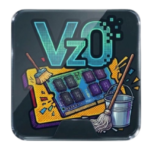
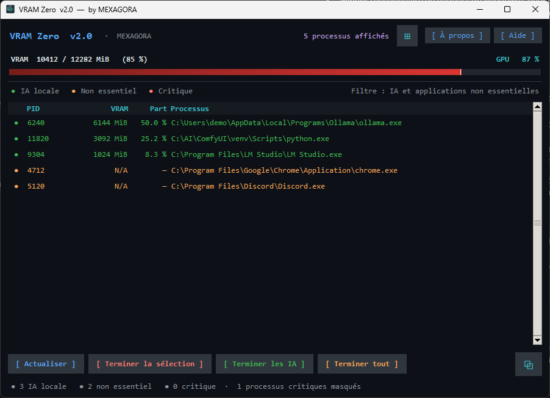

<div align="center">



# VRAM Zero

**Monitor NVIDIA GPU memory and free it by closing the processes that hold it, built for people who run AI models locally.**

[](https://github.com/graphixxgeek-boop/VRAM-Zero-by-MEXAGORA/releases/latest)
[](LICENSE)


[**Download**](https://github.com/graphixxgeek-boop/VRAM-Zero-by-MEXAGORA/releases/latest) · [Français](README.fr.md) · [Report a bug](https://github.com/graphixxgeek-boop/VRAM-Zero-by-MEXAGORA/issues/new/choose)

</div>

<p align="center">
  <br>
  <sub>Screenshot with sample data.</sub>
</p>

## Why

Running Ollama, ComfyUI, LM Studio or a Stable Diffusion UI often leaves VRAM occupied after you are done: a model stays loaded, a Python process lingers, and the next job runs out of memory. Finding the culprit means reading `nvidia-smi` output and killing processes by hand.

VRAM Zero shows what uses your GPU memory, tells local AI tools apart from everything else, and lets you close the ones you choose, after confirmation.

## Features

- Live VRAM and GPU utilisation, refreshed every 3 seconds, across one or several NVIDIA GPUs
- Processes sorted into three levels:
  - **Local AI** (green): Ollama, ComfyUI, LM Studio, llama.cpp, KoboldCpp, Stable Diffusion UIs, and similar
  - **Non-essential** (orange): browsers, launchers, chat apps, creative tools
  - **Critical** (red): Windows and driver components, hidden by default
- One-click actions: close the selection, close all local AI processes, or close everything visible
- Confirmation before every termination, with an extra warning for critical processes
- Copy a plain-text report of the current state to the clipboard
- No network access, no telemetry, nothing written to disk

## Install

**Installer (recommended):** download `VRAM_Zero_Setup_2.0.exe` from the [latest release](https://github.com/graphixxgeek-boop/VRAM-Zero-by-MEXAGORA/releases/latest) and run it.

**Requirements:** Windows 10 or 11 (64-bit), an NVIDIA GPU with its driver installed (provides `nvidia-smi`).

> **winget:** a package submission is planned. This page will be updated when it is available.

### Verify the download

The SHA-256 of each release file is listed in the release notes. In PowerShell:

```powershell
Get-FileHash .\VRAM_Zero_Setup_2.0.exe -Algorithm SHA256
```

### About antivirus alerts

The files are **not yet code-signed**. A signing request has been submitted to the SignPath Foundation. Until then, some antivirus products may flag the program. The application is packaged with PyInstaller and can terminate processes, two traits that commonly trigger heuristic false positives.

VirusTotal results for release 2.0 are published in [`docs/virustotal`](docs/virustotal/): 2 of 69 engines for the installer and 4 of 70 for the executable, none of them Microsoft, Avast, AVG, Kaspersky, ESET or BitDefender.

Everything is built from this repository by [GitHub Actions](.github/workflows/build.yml). You can also read the source or build it yourself.

## Build from source

Requires Python 3 with Tkinter (included in the standard Windows installer). No third-party dependency.

```powershell
python src\vram_zero.pyw          # run from source
.\RECREER_EXE.bat                 # build dist\VRAM Zero\VRAM Zero.exe with PyInstaller
```

To build the installer, open `installer\VRAM_Zero.iss` in [Inno Setup](https://jrsoftware.org/isinfo.php) and compile. See [docs/GUIDE_INNO_SETUP.md](docs/GUIDE_INNO_SETUP.md).

## Good to know

- Data comes from `nvidia-smi`. On Windows, the driver does not always report per-process VRAM (WDDM), so some rows show `N/A`. The global figures at the top stay accurate.
- Only processes reported by `nvidia-smi --query-compute-apps` are listed. Some graphics-only applications may not appear.
- Terminating a process is immediate and unsaved data is lost. Terminating system processes can destabilise Windows, which is why they are hidden by default.

## Project layout

```
src/            application source (vram_zero.pyw)
assets/         icons and images
installer/      Inno Setup script
docs/           guides, VirusTotal reports, images
packaging/      winget manifests
```

## Contributing

Bug reports and ideas are welcome. See [CONTRIBUTING.md](CONTRIBUTING.md). Security issues: see [SECURITY.md](SECURITY.md).

## License

[MIT](LICENSE) © 2026 MEXAGORA
